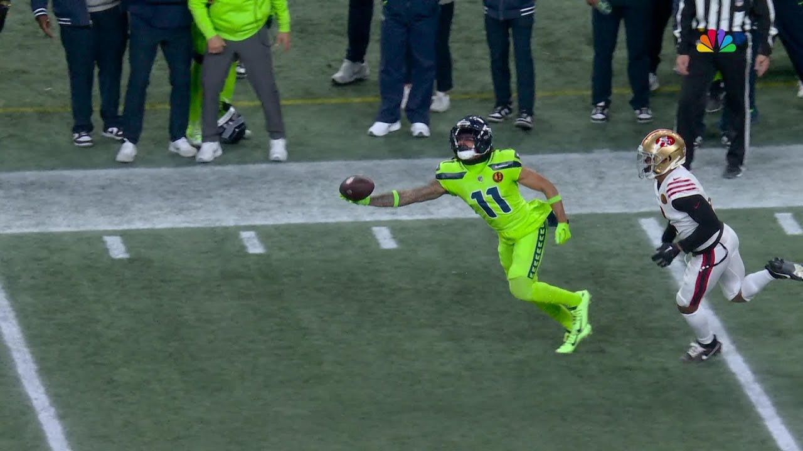

# About Me

Hello! My name is Sathvik Kotapati. I am a student here at the University of Washington. This page says a little about me.

## Academics

I am majoring in Computer Science hoping to minor in both Business and Technical and Professional Communication. I am currently enrolled in **ENGL396: Software Documentation**. When I graduate, I plan to become a software engineer in the tech world, but I would love to work in the sports industry.

Here is a list of my favorite classes at UW:

- [Data Structures and Parallelism](https://courses.cs.washington.edu/courses/cse332/)
- [Introduction to Computer Programming III](https://courses.cs.washington.edu/courses/cse123/)
- [Personal Finance](https://foster.uw.edu/academics/degree-programs/undergraduate-programs/curriculum/minors-and-more-opportunities/)

## Hobbies

*I LOVE the Seahawks*, to the point where a loss can ruin my mood for a few days. I also enjoy watching a lot of other sports along with playing basketball and football in my free time with my friends. I love to travel around the world, most recently I went to Europe and Cancun. I'm hoping to go to Japan in the future with my friends but everyone knows how that goes :)

## Programming Background

I am relatively new to advanced programming. The following table summarizes my experience with different programming languages:

| Language | Experience |
|---------:|------------|
| Python   | Intermediate    |
|  Java    | Advanced with multiple projects|
|  HTML     | Basics and Introductory Knowledge|

## Words of Wisdom

One of my favorite quotes is from Jaxon Smith-Njigba:

> "The only thing better than one Super Bowl is two. So just working to get there, whatever my team needs from me, I make sure I get it done."
